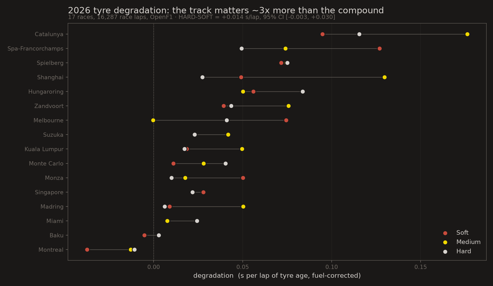
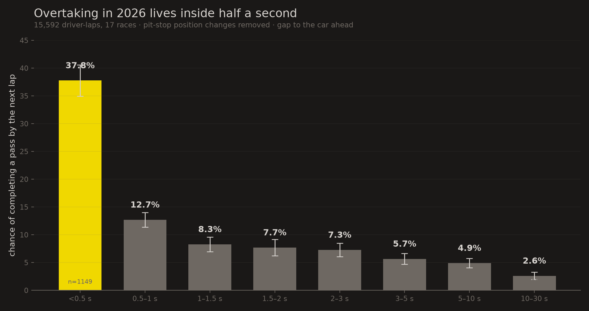
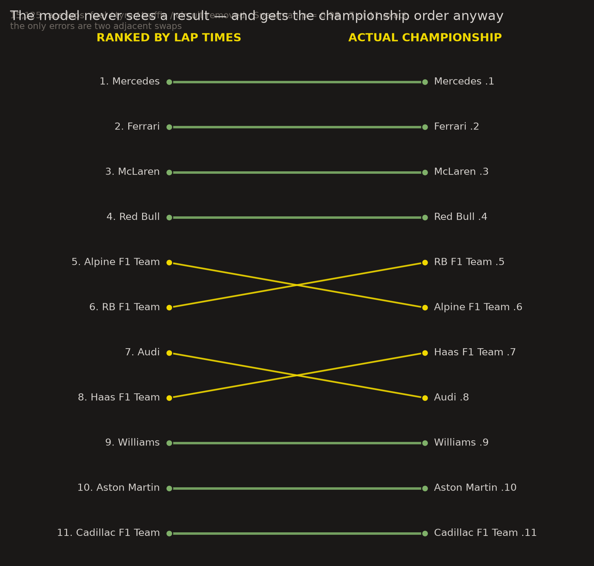
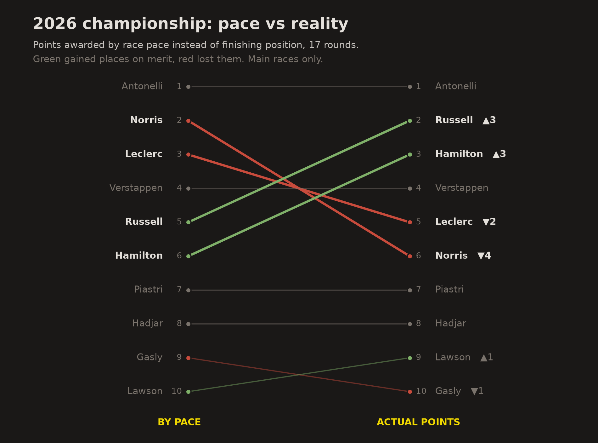
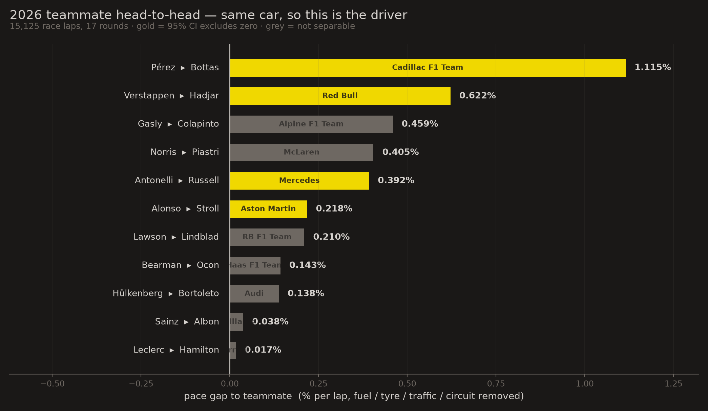
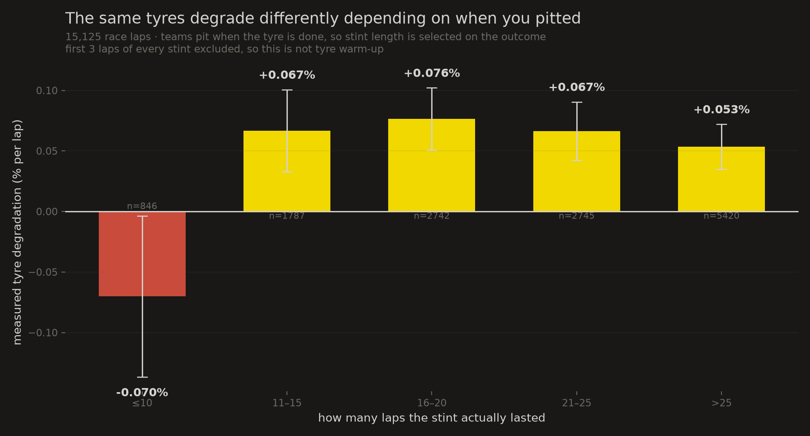
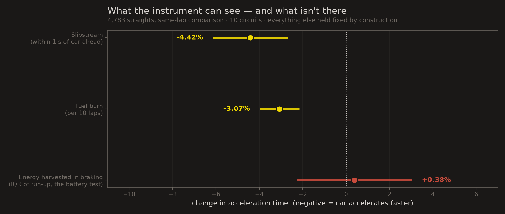

# F1 2026 — what public telemetry can and can't tell you

Statistical analysis of the 2026 Formula 1 season from public data only (OpenF1 + Jolpica).
15,125 race laps, 17 rounds.

Three findings, five null results, and two cases where a statistically significant result
turned out to be an artifact. The nulls and the artifacts are the point as much as the
findings are.

---

## Findings

### 1. Tyre degradation is about the circuit, not the compound

Two published analyses of 2026 disagreed about whether the compound hierarchy had inverted
(hard degrading faster than soft). Neither has the precision to claim it.

```
hard - soft  =  +0.014 s/lap   95% CI [-0.003, +0.030]   p = 0.105
```

Direction is stable (leave-one-circuit-out never flips the sign, 17/17) but it isn't
significant. What settles the argument is that degradation varies **2.9x more across tracks
than between compounds** (sd 0.041 s/lap across circuits vs a 0.014 compound gap).

The trap that produces the disagreement: within a stint, tyre age and race lap advance 1:1,
so degradation and fuel burn are collinear. A model without a fuel term measures
`degradation - fuel_burn`:

| model | soft | medium | hard |
|---|---|---|---|
| naive pooled | +0.016 | **-0.104** | +0.061 |
| + track & driver FE | -0.014 | -0.013 | -0.017 |
| + fuel term | +0.010 | +0.028 | +0.024 |

The middle row says all three compounds get *faster* with age. That's fuel burn, not tyres.

Pre-registered check: fuel coefficient predicted in [-0.03, -0.06], came out **-0.042 s/lap**.



### 2. Overtaking lives inside half a second

The public argument about 2026 overtaking is about raw counts, which depend on how much
close racing happened. Conversion rate is the invariant measure: given a car within X
seconds, how often does a pass follow by the next lap?

Pit-driven position changes removed first (11% of driver-laps, either car changing stint).

| gap to car ahead | pass by next lap | n |
|---|---|---|
| < 0.5 s | **37.8%** | 1149 |
| 0.5 - 1.0 s | 12.7% | 2417 |
| 1.0 - 1.5 s | 8.3% | 1691 |
| 2 - 3 s | 7.3% | 1705 |
| 10 - 30 s | 2.6% | 2334 |

Three times the conversion inside half a second vs 0.5-1.0 s — within the single bracket
usually treated as "within a second".

By circuit: Monza 34.2% highest, Monte Carlo 13.1% lowest (face validity). Baku at 16.8%
is the surprise — historically a big overtaking venue; without DRS the straight alone no
longer appears sufficient.



### 3. Pace vs results

Model: `log(lap_time) ~ driver + circuit + race_frac (fuel) + compound + tyre_age + log1p(gap)`,
cluster-robust by driver x race.

Nuisance effects recovered, all correct in sign (sanity check, not a result):
fuel -3.31% across a race, tyre age +0.032%/lap, traffic -0.214% per e-fold of gap.

**The model never sees a result** — no finishing positions, no points, no winners. Rank the
teams by the pace it produces and compare to the actual constructors' championship:
**Spearman ρ = 0.982, 7 of 11 exact**, with the only errors two adjacent swaps.



Car pace:

| | team | % off fastest |
|---|---|---|
| 1 | Mercedes | — |
| 2 | Ferrari | +0.081 |
| 3 | McLaren | +0.365 |
| 4 | Red Bull | +0.490 |
| 5 | Alpine | +1.690 |
| 11 | Cadillac | +3.961 |

Four cars inside 0.5%, then a 1.2% cliff.

Award points by pace rank instead of finishing position and Antonelli still wins
(299 pace points to 233), but below him it rearranges — **Norris is 2nd on pace and 6th on
points**, with 3 DNFs in 16 races. Russell and Hamilton each gain three places.



Teammate comparison is the only way to separate driver from car. Leclerc vs Hamilton comes
out at **0.017%/lap** over 17 rounds — not separable.



### 4. "Good on tyres" is not a measurable driver skill

Teammate vs teammate, same car, same races. **0 of 11 teams** show a difference whose 95% CI
excludes zero. Smallest p = 0.062, which across 11 tests is what chance gives.

Bound: **±0.58 s per 20-lap stint**, against typical total degradation of 0.68 s over the same
stint. The test could have caught a driver 85% worse on tyres than his teammate. Nobody is.

Team differences are marginal too: joint cluster-robust test p = 0.045.

---

## Five significant results that were wrong

### Floor and ceiling

Comparing pace rank to finishing position showed the slowest cars gaining the most positions
— Pérez +2.33, Bottas, Sainz, Ocon. Apparently the backmarkers are the best strategists.

If your pace ranks 18th you can only move up. Measured, the mechanical component is
**+0.184 positions per pace-rank place** (R² = 0.151, p = 4.5e-12). Ten places back buys
+1.84 positions for free.

Corrected, Pérez drops to 8th and Bottas goes negative. 2 of 21 CIs exclude zero, about what
21 tests give by chance. Real finding is the opposite: **results track pace closely; no driver
systematically beats their own pace over a season.**

### Laps are not independent observations

`statsmodels.anova_lm` reported p = 0 for team degradation differences (F = 868) and
p = 2e-108 for drivers. Both junk — unclustered errors, and consecutive laps on one set of
tyres are heavily autocorrelated.

Antonelli vs Russell, identical coefficient of +0.0096%/lap:

| SEs | 95% CI | p | reads as |
|---|---|---|---|
| unclustered | [+0.0005, +0.0188] | 0.040 | a finding |
| clustered by driver x race | [-0.0150, +0.0343] | 0.442 | nothing |

**2.7x wider.** Always pass `cov_type="cluster"`.

### Survivorship in stint length

Degradation estimated separately by how long each stint actually lasted:

| stint length | measured degradation |
|---|---|
| ≤10 laps | **-0.070 %/lap** |
| 11-15 | +0.067 |
| 16-20 | +0.077 |
| 21-25 | +0.067 |
| >25 | +0.054 |

Short stints say tyres get *faster*. Teams pit when the tyre is done, so a long stint is one
where degradation happened to be low, and a short stint usually ended for reasons unrelated to
wear. Both ends are selected on the outcome.

Ruled out tyre warm-up: dropping the first 3 laps of every stint made the short-stint negative
**stronger** (-0.065 → -0.070).



No clean fix. This is the main unresolved threat to every tyre-degradation number here,
including the ones above.

### Range restriction — conditioning on the outcome

Correlation between grid position and race pace:

| sample | n | r |
|---|---|---|
| whole field | 329 | **+0.833** |
| points finishers (P1-10) | 170 | +0.713 |
| podium finishers (P1-3) | 51 | **+0.168** (p=0.24) |
| outside the points (P11+) | 159 | +0.787 |

Finishing on the podium is caused by both qualifying well and being fast, so conditioning on it
restricts the range on both causes at once. Study only the winners and you conclude the thing
that produced them doesn't matter.

### A weaker one, kept for honesty

SOFT comes out slower than MEDIUM pooled (+0.220%, p=0.074) and faster within driver × race
(-0.096%, p=0.093). The sign flips when the comparison is made inside the same driver and race,
which is the Simpson-shaped story — but neither estimate clears significance, so it's a weaker
illustration than the others.

All of these were statistically significant or directionally convincing, and agreed with what
people already believe. None was caught by looking harder at the output — each was caught by
asking what else could produce that number.

---

## The battery: five pre-registered designs, five nulls

2026 cars are ~50% electric and state of charge is published nowhere. The premise: when the
battery empties the car stops pulling at full throttle, so the effect should be visible.

| # | design | result | why it failed |
|---|---|---|---|
| 1 | clipping shape | null | clipping happens near terminal velocity, where power barely shows |
| 2 | Monza VSC restart | null | one event, ±2.2 km/h floor |
| 3 | 13 safety cars, top speed | null | top speed is drag-dominated |
| 4 | 13 safety cars, acceleration | null | pit filter removed 64% of the sample |
| 5 | within-lap harvest | null | best powered; bound ±1.6% |

Design 4's failure is structural, not bad luck: **a safety car is a confounded experiment by
construction** — the event that refills the battery is the event that makes everyone pit.

Design 5 is the informative one. Same model, same 4,783 straights, same moment: it resolves
fuel burn at p = 1e-10 and the slipstream at p = 1e-22, and sees nothing from energy harvested
in braking.



A follow-up hypothesis (deployment follows a pre-computed per-lap map) predicts that within a
lap, residuals across straights should correlate *negatively* — spend here, pay there. They
correlate at **+0.124**, positive across all 7 circuits. The explanation doesn't survive either.

Honest position: invisible in public telemetry down to ~1.6%, and we don't know why.

Pre-registrations with their falsification conditions are in [`prereg/`](prereg/).

---

## Things worth knowing if you try this

**FastF1 is currently dead.** `livetiming.formula1.com` returns 401 on every season tested,
including 2024. The whole pipeline here uses OpenF1 instead.

**OpenF1's real rate limit is far tighter than its documented 30/min.** Measured: 5 successes
then hard 429s within 3.4 s. Backoff costs more than throttling — settled at 16/min.

**Windowing is the big lever.** Full-race `car_data` is 5.5 MB / 3.6 s per driver; a 17-lap
window is 0.19 MB / 0.3 s.

**The `intervals` endpoint is avoidable.** Gap to the car ahead is derivable from lap-crossing
times you already have. Validated against the API: derived gap reproduces the slipstream at
+11.42 km/h vs the API's +10.98, overlapping CIs. See [`src/gaps.py`](src/gaps.py).

**Three sources disagree about the 2026 calendar.** OpenF1 lists a Bahrain GP on 12 Apr and a
Saudi GP on 19 Apr that FastF1 and Jolpica both deny; requesting laps for either returns 404.
Stale placeholders. The genuinely odd entry — a "Bahrain Grand Prix" at Sepang — is real.

**Concurrency across separate processes doesn't help** (server-side per-IP quota). Threads plus
one shared token bucket is the right shape. See [`src/cfetch.py`](src/cfetch.py).

---

## Reproducing

```bash
uv venv --python 3.12 .venv
uv pip install --python .venv/bin/python -r requirements.txt
```

Data is fetched to `data/` and gitignored (~540 MB, cached so reruns are free).

```bash
.venv/bin/python src/build_tyres.py      # laps + stints, all 17 races
.venv/bin/python src/analyze_tyres.py    # finding 1
.venv/bin/python src/robust.py           # robustness checks for finding 1

.venv/bin/python src/get_results2.py     # results/standings from Jolpica
.venv/bin/python src/pace_build.py       # clean lap dataset
.venv/bin/python src/pace_fit.py         # finding 3 — car and driver pace
.venv/bin/python src/teammates.py        # teammate gaps
.venv/bin/python src/pace_vs_result.py   # pace vs finishing position
.venv/bin/python src/pace_corrected.py   # ...corrected for floor/ceiling
.venv/bin/python src/tyre_skill.py       # finding 4
.venv/bin/python src/overtaking.py       # finding 2
.venv/bin/python src/starts.py           # lap-1 analysis

.venv/bin/python src/find_sc.py          # safety car events across the season
.venv/bin/python src/plan_fetch.py       # select usable events, build the fetch job list
.venv/bin/python src/sc_windows.py       # pin the lap each SC/VSC actually ended
.venv/bin/python src/run_car.py          # windowed telemetry (~10 min, rate-limited)
.venv/bin/python src/withinlap_build.py && .venv/bin/python src/withinlap_accel.py
.venv/bin/python src/withinlap_test.py   # the best-powered battery null
.venv/bin/python src/budget_test.py      # energy-budget hypothesis test
```

Failed designs are kept rather than deleted — `src/trap.py`, `src/vsc_test.py`,
`src/pooled_test.py`, `src/accel_test.py` are battery designs 2 through 4.

[`NOTES.md`](NOTES.md) is the full working record, including the wrong turns.

---

## Caveats

- Lap 1 of the season's sprint races isn't covered; sprint points are excluded from the pace
  championship, so totals sit below official standings.
- `compound` enters the pace model as a control, not an estimate — when a compound gets fitted
  is endogenous. SOFT comes out slower than MEDIUM, which is backwards for raw grip.
- Censoring in the tyre analysis is unresolved: teams pit when tyres are done, so observed
  stints are survivor-biased toward low degradation, plausibly more so for softs.
- Lawson appears for two teams (mid-season move); handled by fitting teammate models per team.
- Season complete through round 17 of 23 (Singapore, 11 Oct 2026).

## Data sources

[OpenF1](https://openf1.org) — timing, telemetry, stints, race control. Free tier.
[Jolpica-F1](https://api.jolpi.ca/ergast/f1/) — results, standings, grids.
